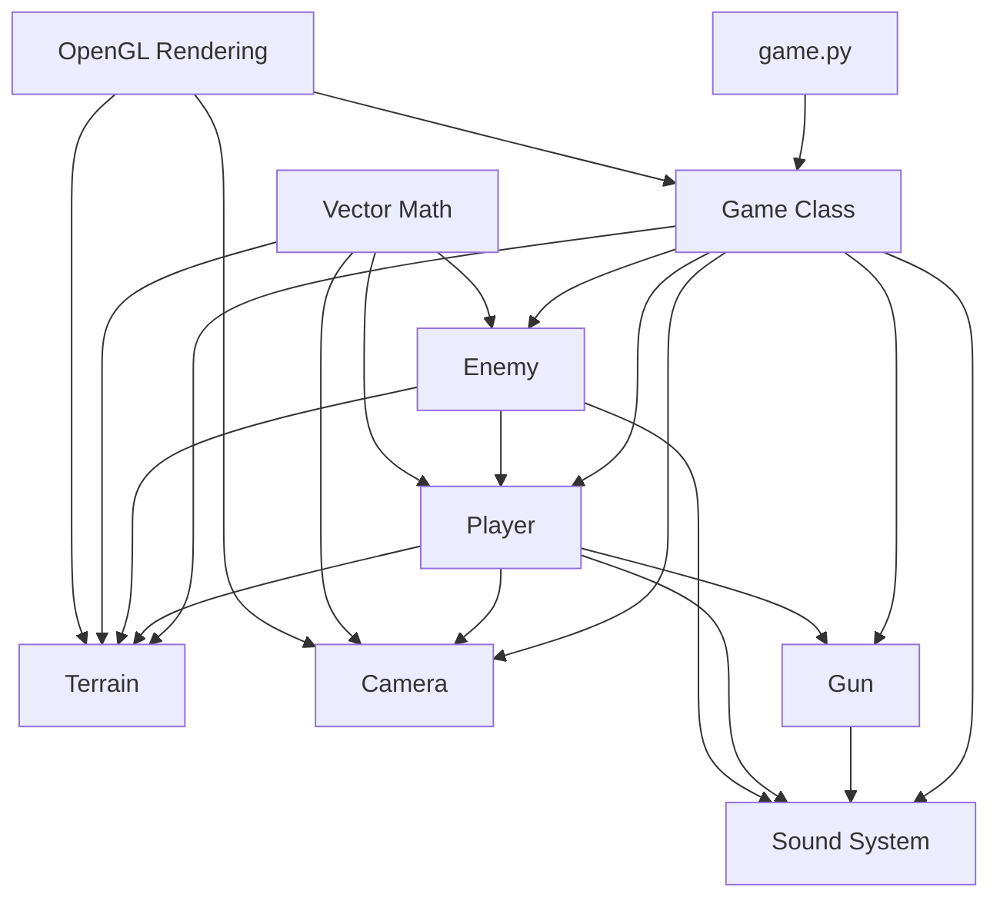
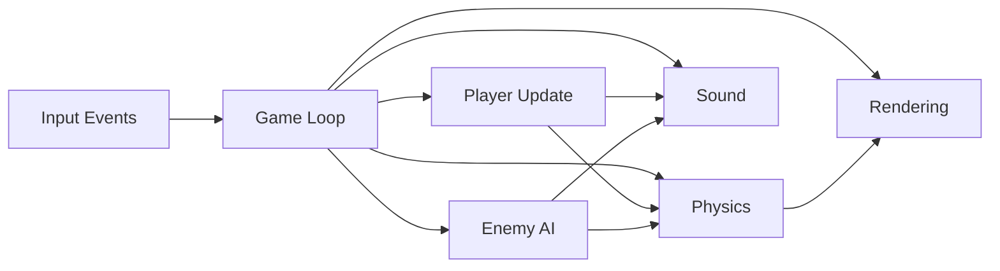
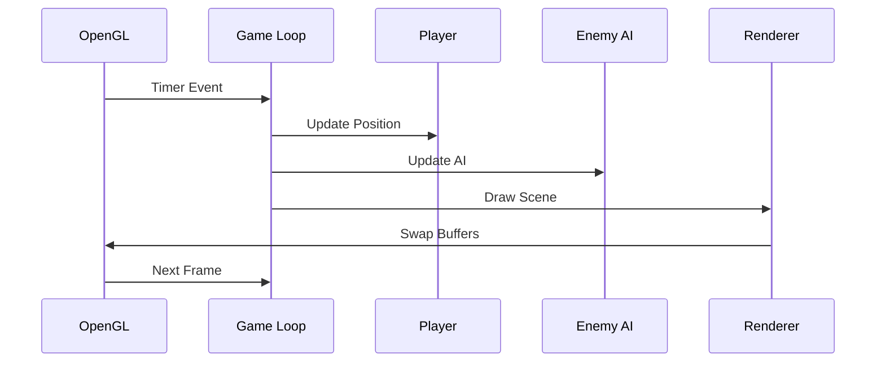

# MummyIsland - Документация проекта

## 1. Структура проекта

### Дерево файлов и папок

```
MummyIsland-main/
├── game.py                 # Главный файл запуска
├── mummy.ico              # Иконка приложения
├── libs/                  # Библиотеки проекта
│   ├── animated.py        # Система анимаций
│   ├── camera.py          # Управление камерой
│   ├── collision.py       # Система коллизий
│   ├── control.py         # Управление
│   ├── enemy.py           # Логика врагов
│   ├── font.py            # Работа с шрифтами
│   ├── game.py            # Основная игровая логика
│   ├── gun.py             # Система оружия
│   ├── misc.py            # Вспомогательные функции
│   ├── models.py          # 3D модели
│   ├── ObjLoader.py       # Загрузчик OBJ файлов
│   ├── player.py          # Логика игрока
│   ├── saveGame.py        # Система сохранений
│   ├── settings.py        # Настройки игры
│   ├── skybox.py          # Небо и окружение
│   ├── sound.py           # Звуковая система
│   ├── terrain.py         # Генерация ландшафта
│   ├── Texture.py         # Работа с текстурами
│   ├── timer.py           # Таймеры
│   ├── trophies.py        # Система трофеев
│   └── vector.py          # Векторная математика
└── assets/                # Ресурсы игры
    ├── font/              # Шрифты
    ├── obj/               # 3D объекты
    │   ├── crow/          # Модели ворон
    │   ├── enemy/         # Модели врагов
    │   ├── king/          # Модели короля
    │   ├── player/        # Модели игрока
    │   ├── pyramid/       # Модели пирамид
    │   ├── Trophies/      # Модели трофеев
    │   ├── water/         # Модели воды
    │   └── weapons/       # Модели оружия
    ├── sounds/            # Звуковые файлы
    │   ├── crow/          # Звуки ворон
    │   ├── enemy/         # Звуки врагов
    │   ├── gun/           # Звуки оружия
    │   └── player/        # Звуки игрока
    └── textures/          # Текстуры
        ├── ground/        # Текстуры земли
        ├── gun/           # Текстуры оружия
        ├── heightmap/     # Карты высот
        ├── onscreen/      # UI текстуры
        ├── other/         # Прочие текстуры
        └── skybox/        # Текстуры неба
```

## 2. Описание файлов

### Основные файлы

#### `game.py` - Главный файл запуска
- **Назначение**: Точка входа в приложение, инициализация OpenGL и игрового цикла
- **Ключевые функции**:
  - `resize()` - Обработка изменения размера окна
  - `Timer()` - Игровой таймер
  - `draw()` - Основной цикл отрисовки
  - `pressedKey()` / `releasedKey()` - Обработка клавиатуры
  - `mouseLookCallBack()` - Обработка мыши
- **Связи**: Импортирует все основные модули из `libs/`
- **Логика**: Инициализирует OpenGL, создает игровые объекты, запускает главный цикл

#### `libs/game.py` - Основная игровая логика
- **Назначение**: Центральный класс игры, управляющий всеми игровыми системами
- **Ключевые классы**: `Game`
- **Основные методы**:
  - `saveGame()` / `loadGame()` - Сохранение/загрузка
  - `cheatCodes()` - Система читов
  - `loop()` - Основной игровой цикл
- **Связи**: Управляет всеми игровыми объектами (игрок, враги, ландшафт, звуки)

#### `libs/player.py` - Логика игрока
- **Назначение**: Управление персонажем игрока
- **Ключевые классы**: `Player`
- **Основные методы**:
  - `moveForward()` / `moveBackward()` / `moveLeft()` / `moveRight()` - Движение
  - `handle_motion()` - Обработка движения
  - `loadSounds()` - Загрузка звуков
- **Связи**: Использует `Camera`, `Gun`, `Terrain`, звуковую систему
- **Логика**: Физика движения, коллизии, анимации, звуки

#### `libs/enemy.py` - Логика врагов
- **Назначение**: ИИ и поведение врагов-мумий
- **Ключевые классы**: `Enemy`
- **Основные методы**:
  - `attack()` - Логика атаки
  - `lookAt()` - Поворот к игроку
  - `loop()` - Основной цикл врага
- **Связи**: Взаимодействует с `Player`, использует анимации и звуки
- **Логика**: Поиск игрока, атака, анимации смерти

#### `libs/camera.py` - Управление камерой
- **Назначение**: 3D камера от первого лица
- **Ключевые классы**: `Camera`
- **Основные методы**:
  - `callPerspective()` - Установка перспективы
  - `processMouseMotion()` - Обработка движения мыши
  - `updateCameraV()` - Обновление векторов камеры
- **Связи**: Используется в `Player`
- **Логика**: Математика камеры, обработка мыши

#### `libs/terrain.py` - Генерация ландшафта
- **Назначение**: Создание и рендеринг 3D ландшафта
- **Ключевые классы**: `Terrain`
- **Основные методы**:
  - `getHeightsFromImage()` - Загрузка высот из изображения
  - `calcNormals()` - Вычисление нормалей
  - `interpolateHeight()` - Интерполяция высот
- **Связи**: Используется в `Game`, `Player`, `Enemy`
- **Логика**: Загрузка карты высот, генерация меша, текстурирование

#### `libs/gun.py` - Система оружия
- **Назначение**: Логика стрельбы и перезарядки
- **Ключевые классы**: `Gun`
- **Основные методы**:
  - `shoot()` - Стрельба
  - `reload()` - Перезарядка
  - `canShoot()` - Проверка возможности стрельбы
- **Связи**: Используется в `Player`, имеет анимации и звуки
- **Логика**: Управление патронами, анимации, звуки выстрелов

#### `libs/vector.py` - Векторная математика
- **Назначение**: Математические операции с векторами
- **Ключевые классы**: `Vec3`, `Vec2`
- **Основные методы**:
  - Математические операции (`+`, `-`, `*`, `/`)
  - `normalize()` - Нормализация
  - `rotate()` - Поворот
  - `distance()` - Расстояние между точками
- **Связи**: Используется во всех модулях для 3D математики
- **Логика**: Векторные вычисления для 3D графики

#### `libs/sound.py` - Звуковая система
- **Назначение**: Управление звуками и музыкой
- **Ключевые классы**: `Sound`, `SoundSeries`
- **Основные методы**:
  - `play()` / `stop()` - Воспроизведение/остановка
  - `isPlaying()` - Проверка статуса
- **Связи**: Используется в `Player`, `Enemy`, `Gun`
- **Логика**: Управление звуками через pygame.mixer

## 3. Архитектура проекта

### Общая структура

Проект построен по модульной архитектуре с четким разделением ответственности:



### Потоки данных



### Игровой цикл



## 4. Библиотеки/фреймворки

### Основные зависимости

| Библиотека | Назначение | Где используется |
|------------|------------|------------------|
| **OpenGL** | 3D графика и рендеринг | Весь проект для отрисовки |
| **GLUT** | Управление окном и событиями | `game.py`, обработка ввода |
| **pygame** | Звуковая система | `sound.py`, воспроизведение звуков |
| **math** | Математические функции | `vector.py`, `camera.py`, физика |
| **random** | Генерация случайных чисел | `enemy.py`, `terrain.py` |

### Специализированные модули

- **ObjLoader**: Загрузка 3D моделей в формате OBJ
- **Texture**: Загрузка и управление текстурами
- **Animated**: Система анимаций для моделей
- **SaveGame**: Сохранение и загрузка игрового состояния

## 5. Точка входа и запуск

### Процесс запуска

1. **Инициализация OpenGL** (`game.py:6-15`)
   - Инициализация GLUT
   - Настройка окна (720x500, полноэкранный режим)
   - Включение мультисэмплинга

2. **Создание игровых объектов** (`game.py:190-192`)
   ```python
   game = Game()
   rec = Record(game)
   ```

3. **Настройка обработчиков событий** (`game.py:193-200`)
   - Клавиатура и мышь
   - Таймер для игрового цикла

4. **Запуск главного цикла** (`game.py:201`)
   ```python
   glutMainLoop()
   ```

### Что выполняется первым

1. Загрузка настроек (`settings.py`)
2. Инициализация игровых систем (`Game.__init__()`)
3. Создание ландшафта (`Terrain`)
4. Создание игрока (`Player`)
5. Создание врагов (`Enemy`)
6. Загрузка звуков и текстур
7. Запуск игрового цикла

## 6. Архитектурные особенности

### Нестандартные решения

1. **Собственная векторная математика**
   - Реализован класс `Vec3` с перегрузкой операторов
   - Оптимизирован для игровых вычислений

2. **Система читов через ввод**
   - Отслеживание последних 8 символов
   - Активация по комбинациям клавиш

3. **Гибридная система рендеринга**
   - OpenGL для 3D графики
   - pygame для звука
   - GLUT для управления окном

4. **Система записи и воспроизведения**
   - Возможность записи игровых сессий
   - Воспроизведение для отладки

### Причины выбора архитектуры

1. **Модульность**: Каждый компонент независим и переиспользуем
2. **Производительность**: OpenGL обеспечивает быстрый рендеринг
3. **Простота**: Минимальные зависимости, легкая сборка
4. **Гибкость**: Легко добавлять новые функции и системы

### Паттерны проектирования

- **Singleton**: Класс `Game` - единственный экземпляр игры
- **Observer**: Система событий через GLUT callbacks
- **Factory**: Создание игровых объектов через классы
- **State**: Управление состояниями игрока и врагов

## 7. Системные требования

### Минимальные требования
- Python 3.6+
- OpenGL совместимая видеокарта
- 2 GB RAM
- 500 MB свободного места

### Рекомендуемые требования
- Python 3.8+
- Современная видеокарта с поддержкой OpenGL 3.3+
- 4 GB RAM
- 1 GB свободного места

## 8. Управление

### Клавиатура
- **WASD** - Движение
- **Пробел** - Прыжок
- **R** - Перезарядка
- **Shift** - Бег
- **ESC** - Выход
- **F1** - Запись/остановка записи
- **F2** - Воспроизведение записи
- **F4** - Переключение полноэкранного режима

### Мышь
- **Движение** - Поворот камеры
- **ЛКМ** - Стрельба

### Читы
- `hackmag` - Бесконечные патроны в магазине
- `maxa` - Бесконечные патроны
- `flash` - Увеличение скорости
- `rocket` - Нулевая гравитация
- `slamdunk` - Высокий прыжок
- `neverdie` - Бессмертие
- `massacre` - Убить всех врагов
- `reset` - Сброс к значениям по умолчанию

## 9. Разработка и расширение

### Добавление новых функций

1. **Новые враги**: Создать класс в `libs/enemy.py`
2. **Новое оружие**: Расширить `libs/gun.py`
3. **Новые уровни**: Добавить карты высот в `assets/textures/heightmap/`
4. **Новые звуки**: Добавить файлы в `assets/sounds/`

### Отладка

- Используйте F1 для записи проблемных ситуаций
- F2 для воспроизведения записи
- Проверьте консоль на ошибки Python
- Используйте читы для тестирования функций

---

---

Автор: legenda  
Telegram: [@LEGENDA_SD](https://t.me/LEGENDA_SD)
